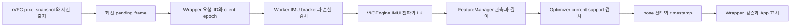

# Flip6 기록 재분석·상용 엔진 비교·적용

- 날짜: **2026-10-13**, Asia/Seoul.
- 범위: 중단된 Oct12–13 작업 복원, Flip6 원본 재계산, REA/WABT 기반 상용 자산 재검사, 최신 엔진 온라인 비교, 확인된 출력 시간 계약 수정, 회귀·Git 기록.
- 현재 결론: **기록 분석과 출력 계약 개선은 가능하나, Flip6 추적 소실·발산 해결은 미입증**. A2/D0/D2/D3의 기존 GT 실패를 보존한다.
- 후속 추적 로직 작업: [239→53 인과 분리·C3 깊이 초기값 A/B](../fixes/2026-10-13-flip6-tracking-recovery-results.md). C3 보정 입력179→250fresh지만 원본 reset2→3으로 기본 채택 실패; 명시적 빌드 옵션 기본 OFF로 보존.
- 인수 상태: `main` / `98b396c`; 미커밋 파일114개·7,545,024bytes를 `build/flip6-analysis-20261013/intake/changed-files.tar.gz`, `files.json`, `diff.patch`에 보존. 기존 코드 변경은 이번에 처음 작성한 것으로 집계하지 않는다.
- 상위 증거: [이전 검증 감사](../../build/flip6-analysis-20261013/prior-validation-audit.md), [현재 로직 역공학](../../build/flip6-analysis-20261013/logic-review.md).

## Flip6 원본 재계산

- 원본4개·PGM600개: `/home/park-ubuntu/Documents/Mobile-SLAM-recordings/{2026-10-07-ZFlip6,2026-10-12-ZFlip6}/`. 읽기 전용 분석, SHA256·영상 payload 크기·순서·IMU prefix 양 끝 bracket 확인.
- 도구: [analyze-flip6-recordings.py](../../scripts/dev/analyze-flip6-recordings.py). 과거 numeric/input 두 schema만 지원, 기존 출력 덮어쓰기 거부, 외부 dependency 추가0.
- 분모: `startedAtMs <= inputTimestamp*1000 < stoppedAtMs`. 전체 recorder 수신행과 시간창 결과를 별도로 집계한다.
- quantile: 정렬값의 `(n−1)*p` 선형 보간. 별도 `statistics.quantiles(method='inclusive')`로 원본 수치 대조.

| 10/12 동일 길이 시간창 | 최적화 전 | 최적화 후 |
|---|---:|---:|
|완료 결과 / fresh|479 / 446|607 / 574|
|initialized coverage|100%|100%|
|fresh coverage|93.1106%|94.5634%|
|결과 처리율|15.9456fps|20.2122fps|
|Lost / 연속 구간|33 / 9|33 / 6|
|관측 engine/client epoch 변화|0 / 0|0 / 0|
|pose age p50 / p95 / p99|68.015 / 117.915 / 129.751ms|74.972 / 120.534 / 137.812ms|
|engine p50 / p95 / p99|29.540 / 63.045 / 84.432ms|33.525 / 69.767 / 94.278ms|
|fresh 수신 간격 최대|856.760ms|632.840ms|
|fresh pose timestamp 간격 최대|974.470ms|646.070ms|

- 전체 recorder 분모:480/447fresh,609/576fresh. 처리율 증가와 p95 지연 감소는 다른 주장이다. 후자는 확인되지 않았다.
- 최적화 후 Lost33개: current visual factor0인29개·1인4개. 해당 행 tracker 중앙값53, historical eligible80, immature146, IMU factor10, IMU rejection0; Ceres·marginalization 미실행.
- 충분한 current factor도 자기일관성을 보장하지 않음: 결과406→407은1.072161m/37.545ms·회전25.903243°·current24, 기록 gyro 적분 상계2.970940°. 결과296→297은회전44.696793°/22.785ms·current9, gyro상계2.215515°.
- 전체609결과의 p95: frontend41.377ms, backend42.453ms, Worker queue0.863ms. 이 기록은 queue 단독 병목보다 영상 제약 소실·frontend/backend tail을 우선 조사할 근거다. 각 stage의 percentile을 합산하지 않는다.
- 한계: 영상·독립 GT·실측 K/extrinsic·물리 exposure/IMU offset 없음. gyro 상계는 기록 시간축의 자기일관성 진단이며 GT 회전 오차가 아니다. 두 시험의 동작 강도·환경·recorder 부하가 달라 차이를 코드 단독 효과로 확정하지 않는다.

| 10/07 저장 범위 | minute1 | minute2 |
|---|---:|---:|
|accepted / 수신 결과|558 / 558|847 / 846|
|저장 영상 / 미복사|300 / 258|300 / 547|
|저장 영상 시간|32.067780s|18.733525s|
|전체 initialized / fresh|426 / 384|198 / 193|
|저장300 prefix historical fresh|186|0|
|첫 fresh의 기록 시작 후 시각|3.118665s|41.116735s|

- `completed=true`와 overflow0은 전체 영상 보존을 뜻하지 않는다. minute2의 최초 fresh는 저장 영상 밖에 있다.
- minute1의 전체 결과에는 기록 시작 전 `stale_epoch`1개가 포함된다. accepted와 결과의 단순 개수 일치만으로 모든 요청 완료를 증명할 수 없다.
- 10/12 numeric 기록은 영상0개이며, 10/07의600PGM을 그 영상으로 대신하지 않는다.

## 동일 저장 입력의 현재 Worker 재시험

- 새 브라우저·현재 Wrapper/Worker·각300PGM·동일 기록 config/IMU로 active loader와 isolated candidate를 각각 재생. input·images·config·parameters·calibration 객체가 두 실행에서 모두 같음 확인. 각 실행의 loader/소스/입력 hash는 adjacent `report.json`에 보존한다.
- 기록 profile: solver0.06s/10iterations, feature120, LK21/3/minDist30, PnP OFF/freq3. 두 loader 모두300행의 rotation rescue readback **OFF**. App 기본ON 또는10/12 numeric 기록의 전체 동작 비교로 확대하지 않는다.
- [candidate minute1](../../build/flip6-analysis-20261013/replay-minute1/report.json), [active minute1](../../build/flip6-analysis-20261013/replay-active-minute1/report.json), [candidate minute2](../../build/flip6-analysis-20261013/replay-minute2/report.json), [active minute2](../../build/flip6-analysis-20261013/replay-active-minute2/report.json).

| 관측값 | active Oct12 / minute1 | current candidate / minute1 | 두 loader / minute2 |
|---|---:|---:|---:|
|입력 완료|300|300|각300|
|initialized|260|140|각0|
|fresh|239 (79.67%)|53 (17.67%)|각0|
|motion guard reset|1|2|각0|
|current support 부족|20|86|해당 없음|
|연속 published translation 최대|3.786020m|0.546416m|pose 없음|
|초기화 timeout|0|0|각1|

- **candidate 승격 보류**: 동일 prefix에서 fresh coverage가 낮아졌다. 작은 pose jump 수치만으로 개선 판정하지 않는다. active의 높은 coverage도128개 bias 경고·3.786m jump와 함께 보아야 하며 GT 정확도 통과가 아니다.
- 이 비교는 두 source bundle의 차이다. 특정 D1/관측정책 하나를 단독 원인으로 확정하지 않는다. 이번 JS 출력 계약 수정이 이 candidate를 새로 만든 것도 아니다.
- 원래 기록의 시작 estimator state·drop/arrival schedule을 재현하지 않는 fresh-lifecycle replay. historical prefix의186/0fresh와 직접 행별 parity를 기대하지 않는다.
- 600frame 처리 완료는 실행 검증만 뜻한다. minute2의 pose0은 정확도 테스트 통과가 아니며, 후반41초의 첫 pose 구간은 저장되지 않았다.

## 현재 실행 경로와 문제



- C++/직접 Worker configure의 rotation rescue 기본값은OFF, 제품 App은Oct12부터ON. 오래된 Oct11의 전체OFF 설명을 현재 App 기본값으로 사용하지 않는다.
- 관측 정책은 기본0; 실패한D2/D3는 명시적 instance opt-in1/2. configure는0, reset은선택 보존, 실제 정책 변경은fresh epoch로 이력을 분리한다.
- 현재 young track은 geometry/rank/condition/reprojection 검사를 통과하면 admit 가능하다. 단순히 나이가 어려서 전부 제외된다는 과거 설명은 부정확하다.
- current support<2이면 prior 해제·window 진행·Lost; historical point 수가 많아도 현재 영상에 연결된 metric 제약을 대체하지 못한다.
- `compensatedParallax2`는 현재 실제 회전 보상을 하지 않는다. 회전과 병진 keyframe 선택 분리는 연구 후보이나, 원인 확정·즉시 기본 활성화 근거는 없다.
- 독립 로직 감사에서 새CRITICAL/HIGH source blocker 없음. 기존 recovery/GT 실패, 미실측 calibration·시간 정렬은 계속 남는다.

## 상용 엔진·온라인 조사와 적용

- [상용 엔진 도구 재검사](2026-10-13-commercial-engine-reinspection.md): REA6.4.0, WABT1.0.42, GNU readelf/objdump2.38의 실제 명령·hash·exit 보존. 8th Wall glue/WASM과 ARCore client/service 구조를 분리한다. ARKit binary/Apple 실행환경 및 Vuforia SDK는 현재 없다.
- [최신 엔진 비교](2026-10-13-slam-engine-landscape.md): 공식 소스·논문·SDK 기준 적용 가능성 비교. 서로 다른 benchmark의 숫자로 최우수 순위를 만들지 않는다.
- 상용 엔진의 비공개 optimizer·threshold를 복구했다는 증거는 없다. 공개 입력/출력 계약과 확인 가능한 경계를 프로젝트 코드와 비교한다.
- **적용1 — 결과별 시간 출처**: 완료된 결과A의 pose age에 새 제출B의 `lastFrameTiming.source`가 섞이는 결함. 기존 한 개의 `_activeFrame`에 제출 timing snapshot을 결합하고, App은 해당 결과의 metadata만 표시한다. metadata가 없으면proxy로 표시한다.
- **적용2 — 미래 pose 출력 차단**: Worker/Wrapper가 입력1.0s에 pose1.1s를 fresh로 수락하고 음수age를 내는 경계 결함. 현재 corrected-pose API에는 미래 prediction 계약이 없으므로 미래 pose·map을 차단하고 원인·요청 identity를 보존한다. 기존 과거 pose timestamp를 별도 보고하는 계약은 유지한다.
- **적용3 — 분석 재현성**: 분모·epoch·prefix 누락·quantile·gyro 자기일관성을 한 도구에서 계산해, 초기화 전 prefix와 실제 실패 구간을 혼동하지 않도록 한다.
- 위 적용은 시간 출처·출력 신뢰성·분석 절차 개선이다. correspondence recovery·metric 정확도·phone 속도 개선으로 확대하지 않는다.
- 다음 알고리즘 후보: 회전/병진 keyframe 분리, 회전만 관측 가능한 상태와 metric 깊이의 구분, 제한된 local 재연결. 기존 warp/D0/D2/D3 실패를 먼저 sentinel로 사용하고, 전체 TUM/held-out/기록 replay/false-ID gate 통과 전 기본값으로 승격하지 않는다.

## 중단된 검증 종결

- 기존 strict churn 비교의 최대pose차`2.386131847664785e−10`와 실패 receipt 유지. 초기 baseline의 OMP/BLAS 환경은 미기록이었다.
- **동일 OLD binary**를 `OMP_NUM_THREADS=1 OPENBLAS_NUM_THREADS=1`로 재생한 보존결과는D1/기본0과400행 exact. 이번에 raw·summary·config를 다시 대조해 timing 이외 차이0, 추가policy1284개 정수0을 확인했다. D1 단독 원인 주장은 철회한다.
- 허용오차0, 임계값 변경0, old golden 교체0. 기본0 보존은 시작A2의 tracking/GT 실패 해결과 다르다.
- 이번 native 재빌드: 현재source에서 incremental build 완료. isolated WASM도`ninja: no work to do`로 build graph 신선도 확인 후 API 재검증.
- WASM candidate SHA256: `38837d4b79abb088610484f4e2c016aac4336fe9761dcfc56874d48e64785589`; source manifest `b95110a78097facda411382c0f2dd90afec1530ff72ae5c0b0deebd7317f9550`.
- 현재active web loader SHA256: `140e29a8d0717daca8b330d50849671ddb13403e0e82ccb9f8f221a764bf1595`; Oct12 산출물로 source14개가현재와 다르다. 이번isolated 검증과active loader의 동일성·서비스 배포를 주장하지 않는다.
- 최종이번QA·Git 결과는 아래 완료표에 기록한다. 과거 문서의PENDING 및 실패 파일을 소급해서 통과로 바꾸지 않는다.

## 완료표

- Native: **209 GoogleTest / 16 suites PASS**. ASan/UBSan: **157 GoogleTest / 8 선택 suite PASS**. system OpenCV/YAML은 prebuilt로 미계측.
- Browser: **Node 285 PASS**, skip/TODO 0; Python exporter 3 PASS. root Python 63 PASS(기록 분석 8 포함). 기존 assertion 삭제·threshold 완화 0.
- 변경 계약: 신규 8개 red 재현 후 green, recorder passthrough·transfer·reentrant callback 포함 targeted 138 PASS. [구현 증거](../../build/flip6-analysis-20261013/provenance-fix/verification.json).
- 기록: [v2 분석](../../build/flip6-analysis-20261013/recording-analysis/historical-recordings-v2.json), [v2 독립 검증](../../build/flip6-analysis-20261013/recording-analysis/validation-v2.json). malformed fresh 입력 0, 기존 통계와 값 동일, PGM 600개 확인.
- 실제 WASM Worker clean101: 400frame·339fresh, warmup 이후 300/300; body-frame SE(3) scale1 ATE **0.014161m**, rotation APE **0.457878°**, 1s RPE **0.011314m/0.245642°**. [독립 GT 평가](../../build/flip6-analysis-20261013/worker-clean101/evaluation.json), association 339/339·timestamp 차이 0. desktop 합성 한 sequence의 통과.
- 실제 App·카메라 fixture·IMU·Worker: 120planned−5warmup=115completed, 57fresh, postwarmup 20/20. **115개 결과 모두 sourceTiming.timestampS=inputTimestamp** 확인. [실행](../../build/flip6-analysis-20261013/app-current/report.json). full400/phone 검증과 구분.
- JS/Python/shell syntax PASS. clangd 23.1.0 symbol 33·error 0. ESLint/TypeScript typecheck는 설정되지 않아 수행하지 않음. reference sensor 1·Vuforia 안전 provision 3계약 PASS; 실제 Vuforia engine 시험 아님.
- WASM public API·policy lifecycle PASS. native/WASM source 86개가 검증 manifest와 동일함 확인. active loader 승격 0.
- [독립 최종 리뷰](../../build/flip6-analysis-20261013/final-review.md): source APPROVE, 신규 blocker 없음. 문서의 JS consumer/실제 C++ recovery 범위와 metadata 검증 표현도 정정했다.
- Git: `origin` fetch 완료, baseline은 origin/main보다 4commit 앞서며 뒤처짐 0. `codex/flip6-analysis-20261013`에 보존된 이전 작업과 이번 분석·수정을 명시적으로 기록한다. 최종 commit/status는 [closure.json](../../build/flip6-analysis-20261013/closure.json)에 기록. 원격 push·main 병합·서비스 배포는 이 작업 범위에 포함하지 않음.
- 실제 phone: ADB 연결 0, 신규 측정 0. HTTPS7002는 stopped 유지. 원본 dataset·TLS·기존 실험·서비스 보존.

## 재현

```bash
python3 scripts/dev/analyze-flip6-recordings.py /absolute/record.json --output build/new-flip6-analysis.json
bash scripts/dev/check.sh syntax
bash scripts/dev/check.sh browser-contracts
python3 -m unittest discover -s tests -p 'test_*.py' -v
OMP_NUM_THREADS=1 OPENBLAS_NUM_THREADS=1 ctest --test-dir build/tracking-performance-20261013/candidate-native --output-on-failure -j2
node scripts/dev/wasm-smoke.mjs build/tracking-performance-20261013/wasm-final/vio_engine.js build/new-wasm-smoke.json
git diff --check
```
