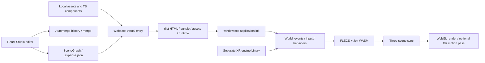

# 8th Wall Studio·ECS·개발 도구 상세 분석 — 2026-10-14

- 범위: 공식 공개 저장소 52개 확보 결과를 바탕으로 현재 `8thwall` monorepo의 Studio/editor, ECS, 자산, 렌더링, 물리, 입력, 패키징, Desktop 및 Agent8 경로 조사.
- 방법: 고정 HEAD의 README·manifest·실제 import/call site·C++ 바인딩·공식 예제 JSON/entry를 정적 추적. 이 문서의 소스 확인은 해당 기능을 실행했거나 성능을 측정했다는 뜻이 아님.
- 원본: `assets/references/8thwall/official/<repo>`; 전체 52개 SHA·LFS pointer·수집 명령은 [공식 저장소 목록](2026-10-14-8thwall-repositories.md).
- SLAM/CV·카메라 엔진 내부 파이프라인·바이너리 동적 실험은 별도 분석 범위. 게임 엔진 ECS의 physics/animation 결과와 SLAM pose 추정 결과를 구분.
- 공개 범위: main README는 MIT framework와 별도 SLAM binary를 구분. archive README는 SLAM·VPS·상당수 서버 코드가 제거되었다고 명시. 공개 저장소 전체 확보를 비공개 구현 전체 복원으로 표현하지 않음. [main README](https://github.com/8thwall/8thwall/blob/4edfa484936a2cc691366eeec5c6e58bb6d4c8bd/README.md#L1-L5), [archive README](https://github.com/8thwall/archive/blob/fccdda4995e1897fec39811cc2b26622fcdc96ea/README.md#L1-L7).

## 고정 소스와 제품 경계

| 저장소 | exact HEAD | 조사 결과 |
| --- | --- | --- |
| `8thwall` | `4edfa484936a2cc691366eeec5c6e58bb6d4c8bd` | 현재 Desktop·ECS·공개 AR 모듈·공유 C++·Studio editor 소스 |
| `archive` | `fccdda4995e1897fec39811cc2b26622fcdc96ea` | 미이관 과거 소스; README가 비활성 유지보수 및 제거된 영역 명시 |
| `desktop` | `5c8e1225e820594d071742e3fcd77ecc3d4fa23e` | published builds 안내; 실제 소스는 main `apps/desktop` |
| `agent8` | `bb71b22e2356268165634b226afe751a9b104869` | Kilo 기반 VS Code agent + Studio 조작 MCP |
| `studio-world-effects-example` | `c489770113bfb8384a2913f0584f65e0cf013c8d` | ECS·SLAM binary 동시 연결과 최신 Studio export 구조 |
| `web` | `72556f9122f5b0e861f55748cc9a938a59691273` | 이전 웹 예제·도우미; 현재 main의 examples 안내가 migration 필요 명시 |

- [Desktop 배포 저장소 설명](https://github.com/8thwall/desktop/blob/5c8e1225e820594d071742e3fcd77ecc3d4fa23e/README.md#L1-L9): Desktop 소스 미공개라는 해석은 현재 snapshot과 불일치.
- [현재 예제 분류](https://github.com/8thwall/8thwall/blob/4edfa484936a2cc691366eeec5c6e58bb6d4c8bd/examples/README.md#L1-L26): Studio 4개, A-Frame 3개, three.js 1개를 공식 시작점으로 안내; `web/examples`는 self-hosted migration, archive project library는 snapshot.
- 공식 조직의 `tauri-fork`, Rust/Swift/Objective-C bridge, TensorFlow/MediaPipe/XNNPACK fork 존재만으로 현재 Desktop이 Tauri이거나 모든 웹 페이지가 해당 라이브러리를 로드한다고 판단하지 않음.

## 편집 → 파일 → 브라우저 실행 구조



- Studio UI 소스: `reality/cloud/xrhome/src/client/studio/`; React/TypeScript, `scene-context`, `derived-scene-context`, inspector/configuration, asset browser, preview, input/action 편집으로 분리.
- `studio-scenegraph-view.tsx:1–20`에서 React, UUID, `SceneGraph`, `react-jss`, SceneContext, deriveScene를 실제 import. `local-sync-context.tsx:150–199`는 디스크 변경을 source file 저장으로 반영; `:317–332`는 반대 방향 source push. 파일 동기화 존재가 원격 공동 편집 서비스의 현재 가동을 증명하지는 않음.
- `SceneGraph` 필드: `activeCamera`, `activeMap`, `inputs`, `sky`, `reflections`, `entrySpaceId`, `spaces`, `objects`, `runtimeVersion`. `Expanse`의 `history/historyVersion`은 merge conflict 해소용이며 runtime 사용 금지라는 소스 주석 존재. [scene-graph.ts:650–670](https://github.com/8thwall/8thwall/blob/4edfa484936a2cc691366eeec5c6e58bb6d4c8bd/c8/ecs/src/shared/scene-graph.ts#L650-L670).
- GraphObject는 transform·parent·prefab·custom components 외에 geometry/material/light/audio/gltf/collider/UI/image-target 등 데이터 보유. ECS runtime entity와 JSON object ID 사이 변환·prefab/space 처리는 `runtime/scene-handle.ts`, `prefab-entity.ts`, `shared/object-hierarchy.ts`에 분리.
- CRDT: `shared/crdt.ts:3`의 Automerge import, `:46–80`의 property별 direct/merge 정책, `:573–618`의 save/clone/merge/change/changeAt/getChanges 호출 확인. history 문자열 존재만을 단순 JSON undo stack으로 해석하면 안 됨. [CRDT 구현](https://github.com/8thwall/8thwall/blob/4edfa484936a2cc691366eeec5c6e58bb6d4c8bd/c8/ecs/src/shared/crdt.ts#L573-L618).
- 공식 예제 build entry는 `.expanse.json` import 후 `history/historyVersion` 삭제 → `window.ecs.application.init(scene)` 호출. HMR에서는 `updateBaseObjects`, `updateDebug` 적용. [entry-plugin.js:1–28](https://github.com/8thwall/studio-world-effects-example/blob/c489770113bfb8384a2913f0584f65e0cf013c8d/config/entry-plugin.js#L1-L28).

## ECS 게임 엔진의 실제 실행 순서

- `application.ts:66–103`: `THREE.WebGLRenderer({antialias: true})`, shadowMap 활성화, canvas append, `createWorld`, `loadScene`, effects attach.
- `application.ts:107–155`: world tick → scene matrix refresh/render → motion pass → animation loop. `setAnimationLoop`과 외부 manual render 경로 제공; 모든 환경에서 독립 `requestAnimationFrame` 중복 실행을 가정하지 않음. [application](https://github.com/8thwall/8thwall/blob/4edfa484936a2cc691366eeec5c6e58bb6d4c8bd/c8/ecs/src/runtime/application.ts#L66-L155).
- `world-create.ts:130–158`: full tick은 `updateTime → xrManager.tick → flushEvents → gamepad loop → input actions → runBehaviors → asm.progressWorld → physics events → scene sync`. partial tick은 시간 delta를 비우고 paused XR background/scene만 동기화. zero tick도 별도 정의. [world pipeline](https://github.com/8thwall/8thwall/blob/4edfa484936a2cc691366eeec5c6e58bb6d4c8bd/c8/ecs/src/runtime/world-create.ts#L130-L158).
- JS/WASM 경계: `asm.ts:6–39`의 generated ECS import → Promise 초기화 → `_c8EmAsm_` 접두사 export alias → `HEAPU8.buffer` DataView. raw pointer와 생성 타입은 `c8/ecs/gen` 및 `ecs-js.cc`가 연결. [asm.ts](https://github.com/8thwall/8thwall/blob/4edfa484936a2cc691366eeec5c6e58bb6d4c8bd/c8/ecs/src/runtime/asm.ts#L1-L44).
- FLECS는 README 언급만이 아니라 `ecs-js.cc:28` include 및 `c8/ecs/BUILD` dependency에 존재. 고정 소스는 FLECS v4.0.2 commit `bf9ec9f8aecd987bee63e6c0af4164c7be14b42f`; Jolt v5.3.0 commit `0373ec0dd762e4bc2f6acdb08371ee84fa23c6db`. [MODULE.bazel:344–358](https://github.com/8thwall/8thwall/blob/4edfa484936a2cc691366eeec5c6e58bb6d4c8bd/MODULE.bazel#L344-L358).

## 기술별 근거·적용 위치·검증 범위

- 표의 **호출 확인**은 해당 기능의 source import/call site 확인. 이번 lane에서 실제 browser/Desktop 기능 실행·성능 수치 측정은 수행하지 않음.
- 아래 `R/` = main `c8/ecs/src/runtime/`; `S/` = main `c8/ecs/src/shared/`; `E/` = main `reality/cloud/xrhome/src/client/studio/`. 모든 행은 위 main SHA에 고정.

| 영역 | 확인한 기술·데이터 처리 | 구체적인 근거 | 남은 확인 |
| --- | --- | --- | --- |
| 자산 로드 | manifest 경로→배포 URL mapping; fetch→Blob→object URL; 성공 캐시 및 진행 중 Promise dedup; clear 시 URL revoke | `R/asset-manager.ts:42–115` | 실패 후 retry·clear/reload·장기 메모리 동작 |
| GLTF/GLB | Three GLTFLoader+DRACOLoader, resource base의 `draco/` decoder 지정 | `R/loaders.ts:6–19` | 실제 decoder fetch·decode·모바일 시간 |
| 외부 glTF 자산 | main blob으로 parse하되 secondary relative image는 remote URL 기준; 로드 중 entity 변경으로 오래된 promise 결과가 적용되지 않도록 확인 | `R/systems/gltf-system.ts:286–322` | 다중 asset/CORS 실패·dispose 실험 |
| Raycast 가속 | three-mesh-bvh를 Three prototype에 연결; glTF geometry·face geometry·primitive에 bounds tree 생성 | `R/set-three.ts:13–21`, `R/systems/gltf-system.ts:309` | 실제 BVH speedup·tree 갱신 정확성 |
| 모델 animation | entity별 Three AnimationMixer, finished/loop event, ECS transform tween | `R/systems/gltf-system.ts:86,177–211`; `R/animation.ts:1,224–289` | 스켈레톤·crossfade·clip 조합 시각 결과 |
| PBR material | MeshPhysicalMaterial 생성/재사용; roughness/metalness/opacity/maps, texture filtering/mipmap, side/depth 옵션 | `R/systems/material-system.ts:27–92` | shader variant·GPU 비용 |
| 기타 material | unlit, hider, shadow, video material을 개별 system으로 구현 | `R/systems/{unlit,hider,shadow,video}-material-system.ts` | occlusion·alpha·깊이 순서 실기 |
| 환경광/반사 | scene/space reflections 선택, HDR/EXR 확장자 분기에서 RGBELoader 선택, equirectangular environment mapping | `R/scene-environment.ts:11–40` | EXR 분기가 존재해도 실제 EXR decode 지원은 미검증 |
| Fog/sky | Three.Fog/FogExp2, background material 및 XR 시 sky hide/show | `R/effects-manager.ts:14–128` | 기기별 composite·색 공간 |
| 후처리/모션 | XR motion ShaderMaterial, previous/current camera/object transform, target texture 교체; `space-warp` feature 조건부 실행 | `R/motion-render-pass.ts:30–116,139–169` | XR layer·space-warp 실제 장치 실행 |
| 범용 후처리 범위 | 조사한 application/effects 경로에서 bloom/SSAO/FXAA composer의 기본 사용 근거 없음 | `R/application.ts`, `R/effects-manager.ts` | 저장소 전체 부재라는 증명은 아님; demo별 추가 가능 |
| 물리 | Jolt single-thread job system, 10 MB allocator 주석, 최대 body 65,536 / pairs 65,536 / constraints 10,240; Update(dt,1,...) | `c8/ecs/physics.cc:28,52–54,245–295,918` | 수치는 설정 한도; 달성 throughput 아님 |
| 물리 collider | box/capsule/convex/cylinder/sphere, dynamic/kinematic, gravity factor/DOF, collision start/end를 ECS event로 전송 | `physics.cc:30–36,604–714,890–918`; `R/physics-events.ts` | 접촉 안정성·충돌률·단위별 회귀 |
| Audio | Three AudioListener/AudioContext + compressor; asset blob 기반 media element 연결 및 positional 설정 | `R/audio-manager.ts:71–76,147–158` | autoplay permission·공간 음향 실기 |
| Video | video manager/texture, material 사용 video 집합 추적/정리, 별도 playback controls | `R/video-manager.ts`; `R/systems/material-system.ts:85–105` | iOS decode·texture upload·A/V sync |
| Particle | three-nebula의 emitter/rate/mass/life/radial/vector velocity; sprite 또는 glTF 자산 | `R/particles.ts:1–38,125–157` | 큰 emitter 수·transparency 비용 |
| UI | Yoga async WASM load 및 flex layout, 3D UI와 raycast event | `R/yoga.ts:4–18`, `R/ui.ts:3–6`, `R/ui-events-raycaster.ts` | touch/layout 성능·접근성 |
| Input | pointer/keyboard/gamepad listener, action map, UI raycast; frame 단계에서 gamepad polling/action 적용 | `R/world-create.ts:107–114,145–152`, `R/input-manager.ts:141` | 실제 gamepad·멀티터치 |
| Splat | 별도 splat-loader.js 동적 로드, splat-worker.js worker URL, Blob Uint8Array→Model manager | `R/systems/splat-system.ts:24–64` | 자산 형식·정렬·GPU 비용; SLAM dense map 증거 아님 |
| Editor texture 최적화 | glTF Transform NodeIO + textureCompress(targetFormat=webp,resize) worker | `E/worker/gltf-transform-worker.ts:1–50` | 결과 화질/호환성 |
| Editor mesh 최적화 | dedup→instance→weld→MeshoptSimplifier(error=1,ratio,lockBorder)→resample→prune→sparse(ratio=.2) | `E/worker/gltf-transform-worker.ts:53–88` | error 단위·정량 geometry 손실 |
| Worker backpressure | 변환 type별 실행 1개+최신 pending 1개 유지; 과거 pending 버림 | `E/worker/gltf-transform-worker.ts:11–19` | burst 입력 후 최종 결과·취소 semantics |
| Scene behavior | registerComponent, schema, state machine, entity event, query/prefab API | `R/registry.ts`, `R/state-machine.ts`, 예제 `src/tap-to-place.ts` | 사용자 component sandbox 보장 아님 |

- 자산 처리 원문: [asset-manager](https://github.com/8thwall/8thwall/blob/4edfa484936a2cc691366eeec5c6e58bb6d4c8bd/c8/ecs/src/runtime/asset-manager.ts#L42-L115), [GLTF load](https://github.com/8thwall/8thwall/blob/4edfa484936a2cc691366eeec5c6e58bb6d4c8bd/c8/ecs/src/runtime/systems/gltf-system.ts#L286-L322), [editor worker](https://github.com/8thwall/8thwall/blob/4edfa484936a2cc691366eeec5c6e58bb6d4c8bd/reality/cloud/xrhome/src/client/studio/worker/gltf-transform-worker.ts#L1-L88).
- 후처리 구분: [XR motion pass gate](https://github.com/8thwall/8thwall/blob/4edfa484936a2cc691366eeec5c6e58bb6d4c8bd/c8/ecs/src/runtime/motion-render-pass.ts#L139-L169)는 XR compositor를 위한 motion/depth 출력 경로. SLAM 결과의 pose smoothing이나 카메라 영상 ML 후처리를 의미하지 않음.

## 패키지·빌드·배포

- `packages/ecs/package.json`: 공개 패키지 `@8thwall/ecs` 3.2.1, 배포 파일은 index.js/d.ts, metadata.json, dev8, dist. import만으로 엔진이 로드되는 구조가 아니라 window.ecs 접근 helper이며 runtime.js script 별도 필요. [ECS 사용 문서](https://github.com/8thwall/8thwall/blob/4edfa484936a2cc691366eeec5c6e58bb6d4c8bd/packages/ecs/README.md#L11-L52).
- 내부 `c8/ecs/package.json`: patched Three `three-8w-0-md3cykn0.172.0.tgz`, Automerge ^3.2.4, three-mesh-bvh ^0.8.2, three-nebula ^10.0.3, Yoga ^3.1.0. `@types/three ^0.166.0`는 타입 패키지이며 runtime Three 버전으로 읽으면 안 됨. caret은 선언 범위; 정확한 설치 결과는 lockfile/실제 install 증거 필요.
- `ecs:prepare`: `bazel build //c8/ecs:ecs-asm --config=wasm` → generated JS copy; webpack으로 TS runtime bundle. `test`는 Bazel native/Node 구성을 둘 다 실행하도록 선언. 이번 lane에서 빌드/테스트 실행하지 않음.
- 공식 Studio 예제 webpack: runtime dist를 `external/runtime`, 사용자 assets를 `assets`, image-targets를 `image-targets`로 복사; `@8thwall/ecs` external을 `window.ecs`로 지정; production bundle 및 development HMR/dev8 wiring. [webpack config:24–80](https://github.com/8thwall/studio-world-effects-example/blob/c489770113bfb8384a2913f0584f65e0cf013c8d/config/webpack.config.js#L24-L80).
- world 예제 index는 `external/runtime/runtime.js`와 `@8thwall/engine-binary@1/dist/xr.js`를 별도 script로 로드, binary에 `data-preload-chunks="slam"`. 게임 runtime와 XR binary를 같은 artifact로 취급하지 않음. [index.html:17–18](https://github.com/8thwall/studio-world-effects-example/blob/c489770113bfb8384a2913f0584f65e0cf013c8d/src/index.html#L17-L18).
- static dist 구조로 self-hosting 가능하다는 소스 근거와 실제 HTTPS/CORS/CDN 배포 검증은 별개. 과거 hosted platform은 main README에서 sunset 명시; archive server 경로 존재가 현재 서비스 제공을 의미하지 않음.

## Desktop와 Agent8

- Desktop `apps/desktop/package.json`은 Electron ^38.2.0, electron-builder ^26.0.12, Node 22.x. React editor 개발 README는 xrhome Node 18.17.1과 desktop Node22 환경을 분리. 현재 Desktop 구현을 조직의 Tauri fork만 보고 Rust/Tauri로 분류하지 않음. [Desktop package](https://github.com/8thwall/8thwall/blob/4edfa484936a2cc691366eeec5c6e58bb6d4c8bd/apps/desktop/package.json#L1-L52).
- 실제 실행 연결: `project/run-commands.ts:11–66`에서 bundled npm 또는 project command 실행; `:121–134`에서 build/serve. `local-server.ts:37–46`는 primary 58000–58999, build 59000–59999, dev8 socket 60000–60999에서 가용 port 선택 후 serve/WebSocket/proxy 구성. [local server](https://github.com/8thwall/8thwall/blob/4edfa484936a2cc691366eeec5c6e58bb6d4c8bd/apps/desktop/src/project/local-server.ts#L25-L46).
- `core/application-state.ts:1–15`: better-sqlite3 실제 import와 DB 생성. `file-watch`, `file-sync`, `image-targets`, `transport` 모듈로 파일 감시·동기화·이미지타깃·IPC를 분리. package의 sharp/chokidar/archiver/ws 존재는 선언 증거이며, 각 기능의 end-to-end 성공은 별도 검증 필요.
- Agent8은 VS Code/Kilo 기반 개발 보조 도구. AR rendering/SLAM runtime가 아님. [agent8 README](https://github.com/8thwall/agent8/blob/bb71b22e2356268165634b226afe751a9b104869/README.md#L1-L9).
- `mcp/src/index.ts:22–44,100–101`: `8w-mcp` stdio server, 등록 도구 5개(codeGen, sceneGen, validateComponent, validateProjectBuild, docs). 도구 요청에서 JWT payload·Opik trace metadata를 사용. [MCP registry](https://github.com/8thwall/agent8/blob/bb71b22e2356268165634b226afe751a9b104869/mcp/src/index.ts#L22-L77).
- `mcp/src/factory/websocket-factory.ts:4–34`: `ws://localhost:62008` 연결. `scene-gen/handler.ts:1–17,45–77`: LangChain HumanMessage→scene agent.invoke(recursionLimit=100), sceneReadonly 입력; scene mutation 도구와 코드 작성/빌드 validator를 연결. [scene tool](https://github.com/8thwall/agent8/blob/bb71b22e2356268165634b226afe751a9b104869/mcp/src/tools/scene-gen/handler.ts#L1-L75).
- source 존재와 서비스 독립 실행 가능성 구분: Desktop open-project, LLM/API/auth/telemetry 경로 조건을 실행 검증하지 않았음. 전체 Agent8를 완전 offline solution이라고 주장할 근거 없음.

## 공식 예제 JSON 정적 실험

- 실험: Python 표준 `json`으로 네 공식 Studio 예제 `src/.expanse.json`을 실제 parse; object/space 수와 property 존재 개수 계산. LFS model payload는 읽거나 실행하지 않음.
- 모든 예제 JSON parse 성공. 네 예제 모두 non-empty `history` 없음. 수치는 정의된 object 수이며 동시에 spawn된 entity 수·렌더링 수·실행 성공 수가 아님.

| 예제 | objects | spaces | gltfModel | collider | imageTarget | UI |
| --- | ---: | ---: | ---: | ---: | ---: | ---: |
| studio-face-effects-example | 10 | 1 | 2 | 0 | 0 | 2 |
| studio-image-targets-example | 57 | 5 | 18 | 1 | 7 | 8 |
| studio-physics-playground-example | 188 | 1 | 121 | 146 | 0 | 8 |
| studio-world-effects-example | 14 | 1 | 1 | 0 | 0 | 7 |

```bash
python3 - <<'PY'
from pathlib import Path
import json
root = Path('assets/references/8thwall/official')
for repo in sorted(root.iterdir()):
    path = repo / 'src/.expanse.json'
    if not path.exists():
        continue
    scene = json.loads(path.read_text())
    objects = list(scene.get('objects', {}).values())
    counts = {key: sum(key in obj for obj in objects)
              for key in ('gltfModel', 'collider', 'imageTarget', 'ui')}
    print(repo.name, len(objects), len(scene.get('spaces', {})),
          bool(scene.get('history')), counts)
PY
```

## 전체 저장소를 읽을 때의 의존성 판정

| 저장소 집합 | 이번 조사에서의 취급 | 확인하지 않은 주장 |
| --- | --- | --- |
| 8thwall, engine, desktop, archive, web, 8thwall.github.io | 현재 소스/배포/artifact/역사 예제/문서 경계 구분 | 전부 동일 버전의 하나의 runtime이라는 주장 |
| 공식 Studio 4개, A-Frame 3개, three.js 1개, Discord 예제 | entry/config/scene가 연결 방식을 보여주는 참고 입력 | 모든 예제를 실행·호환성 확인했다는 주장 |
| 8frame, three.js, aframe-particle-system-component, webxr-samples | framework/예제 fork 보유; 실제 resolved URL과 source import로 재판정 | clone한 fork HEAD와 배포 CDN artifact의 동등성 |
| FLECS/Jolt(조직 clone 52개 밖의 외부 upstream) | MODULE.bazel pin + C++ 실제 include/call로 사용 확인 | 조직 목록만으로 의존성 완전 수집 가능하다는 주장 |
| Bazel/Emscripten/Node 및 C++/serialization/ML/media fork | 공급망·도구체인 분석 입력; runtime 활성 의존성 여부는 target graph/링커/동적 호출로 추가 판정 | 31 fork 전부 SLAM 또는 웹 runtime dependency |
| Agent8 및 testing-can-delete 변형 | 개발 도구와 시험용 fork를 제품 runtime와 분리 | 시험 저장소가 지원되는 제품 기능이라는 주장 |
| go-links/YOURLS/auth plugin/bazel-issue 등 | 조직 운영·지원 도구; 전체 inventory에 보존 | SLAM 내부 기능이라고 해석 |

- 사용 확인 단계: `package/MODULE 선언 → source import/include → target graph → 실제 artifact 포함 → runtime 호출 → 측정`. 이번 문서는 주로 앞의 두 단계와 예제 JSON parse까지 확보.
- 미검증: 모든 package 설치/전체 Bazel build, Desktop GUI 구동, Agent8 인증·LLM 연결, 전체 LFS asset, editor round-trip, 모바일 physics/render benchmark, 실제 AR 기능과 SLAM 성능.
- Mobile-SLAM에 직접 적용할 때 후보: asset Promise dedup/명시 dispose, build-time editor history 제거, 실행/paused tick 분리, worker 최신 pending 하나 유지, 단계별 renderer/XR 책임 분리. 적용 전에 기존 sensor timing/pose freshness 및 worker capture 회귀 확보 필요. 이 조사에서 Mobile-SLAM runtime 변경 없음.
