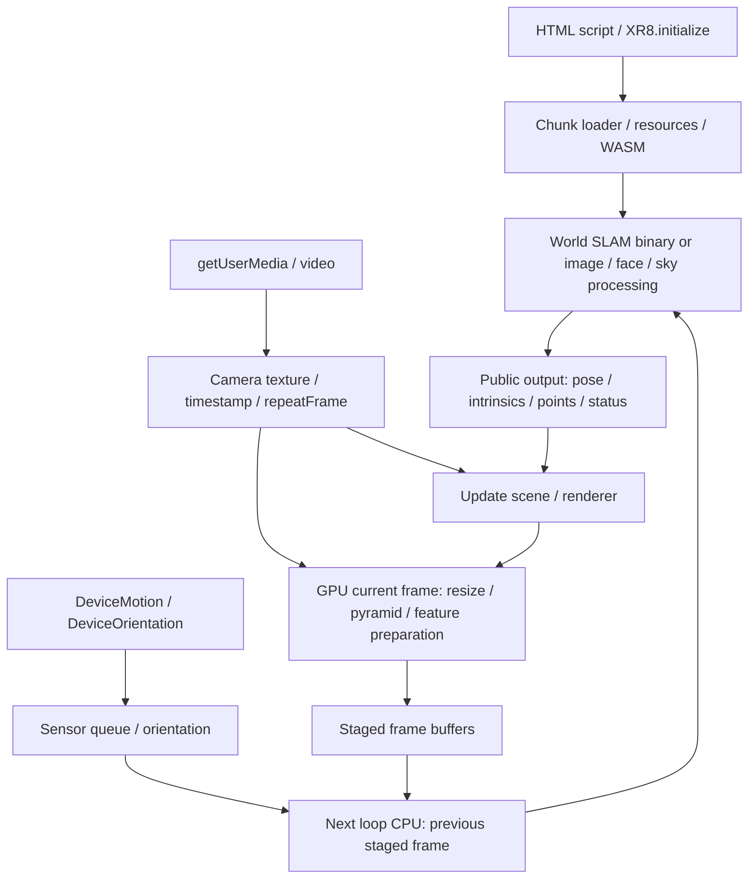

# 8th Wall 전체 기술 조사·바이너리 분석·실행 실험 — 2026-10-14

- 요청: 공식 저장소 전체 clone, 공개 binary 사용, 데이터 로드·처리·아키텍처·파이프라인·SLAM·후처리 상세 분석과 실험.
- 사용자 제공 전제: 바이너리 분석에 대한 법률 검토를 받았으며 전체 프로젝트 분석을 승인했다고 명시. 본 보고서는 그 승인 범위에서 기술 조사 수행; 독자적인 법적 판정 없음.
- 산출물: 공식 공개 저장소 **52개**, 공개 소스 기술 지도, 원본 embedded WASM **5개** 역분석, 원본 binary 브라우저 조건별 실험, binary residual 수치 검사 **6개**, 원본 TypeScript 직접 실행 검사 **9개**.
- 조사 범위와 확정 수준은 아래 표 참조. private SLAM 원본 소스·모든 수식·상태·threshold를 완전히 복원했다는 의미 아님.
- 제품 estimator·실서비스·원본 dataset 변경 없음. 신규 연구 도구와 문서 작성, clone은 ignored `assets/references/8thwall/official/`, 원시 증거는 ignored `build/8thwall-deep-20261014/`에 보존.

## 상세 기록

| 문서 | 내용 |
| --- | --- |
| [공식 저장소 전체 목록](2026-10-14-8thwall-repositories.md) | 52개 remote/HEAD/branch/license/LFS, clone·재사용 검증 |
| [엔진 아키텍처·데이터 흐름](2026-10-14-8thwall-architecture.md) | loader, camera/IMU, GPU/CPU, feature, image/face/sky, rendering, 공개/비공개 경계 |
| [Studio·ECS·도구·배포](2026-10-14-8thwall-ecosystem.md) | scene/asset/physics/audio/material/editor/build, 예제와 fork 구분 |
| [바이너리 내부 분석](2026-10-14-8thwall-binary.md) | WABT/radare2, ABI·call graph, SIMD/memory, Ceres/residual 문자열과 코드 참조 |
| [브라우저 제어 실험](2026-10-14-8thwall-experiments.md) | 입력·scale·센서·world tracking·recenter·pause/resume 제어, 원본 SDK 결과 |
| [공개 소스 직접 실행](2026-10-14-8thwall-source-experiments.md) | pixel/crop/rotation, chunk parser, callback 제거, lifecycle, resource set 9/9 |

## 출처·재현성

- 공식 inventory: GitHub 조직 API page1=52, page2=0. **52/52 clone, 실패0**; 이후 **52/52 비파괴 재사용** 확인.
- clone은 default branch의 shallow checkout. 모든 Git history/tag·submodule·LFS asset 다운로드와 구분.
- LFS **6,408개 pointer**, 선언 크기 합계 **7,453,258,877 bytes**. 이 pointer들을 사용 가능한 데이터로 계산하지 않음.
- 공개 core 소스: `8thwall/8thwall@4edfa484936a2cc691366eeec5c6e58bb6d4c8bd`.
- binary 배포: `8thwall/engine@e1421ae742a9c5d654871367c64c1de3ad044caf`.
- binary archive는 기존 실제 LFS 객체 **13,998,848 bytes**, SHA256 `a2fc73ba450c1a96ee2a20db442f7fb328a3c8b76565e7e9d15b68cd75c86a93`; 새 clone의 pointer OID와 일치. JS/WASM은 pointer가 아닌 실제 bytes로 분석·실행.
- core source revision과 binary 배포 revision이 다르므로 소스의 구현을 binary에 그대로 대응시키지 않음. 동일 API·구조는 비교 근거이며 build parity 증명이 아님.
- 공식 원문 **12개 HTTP200** 새 획득: [primary manifest](../../build/8thwall-deep-20261014/primary/manifest.json). URL·획득시각·bytes·SHA 보존; Context7 조회 후 공식 원문 확인.
- [공식 공개 범위](https://8thwall.org/docs/open-source): MIT framework는 image/face/sky 및 core architecture, world SLAM은 별도 binary. VPS/Maps/Hand Tracking은 해당 binary 포함 기능이 아님.
- 기존 `assets/references/8thwall/engine/README.md` 등의 추정·의사코드 문서는 공식 source 복원 증거로 사용하지 않음. 새 보고서의 pinned source, binary address, 실행 결과를 우선 근거로 사용.

## 확인한 핵심 구조

- **프레임 지연 구조:** source의 실제 loop는 이전 stage의 CPU 처리·scene update 후 camera upload/render, 현재 영상 GPU 준비를 수행. 단순한 동일 프레임 `GPU→CPU→render` 도식으로 timestamp를 연결하면 잘못된 latency·pose association이 생김.
- **공개 feature frontend:** GPU pyramid/FAST 계열 score 처리와 CPU ORB/GORB 기술을 확인. GORB는 orientation/gravity 관련 입력을 사용. 해당 기술의 존재와 private world SLAM의 전체 estimator 구성은 별도.
- **공개 tracker의 범위:** 공개 `Tracker::track`에서 image-target 처리를 확인하지만 world pose를 완전 갱신하는 private SLAM source는 없음. 이름 `Tracker`만으로 완전한 world SLAM이라고 결론 내리지 않음.
- **바이너리 내부 최적화:** Ceres 관련 code path·RTTI·residual 정보를 확인하고, data offset→linear-memory address→instruction xref→직접 도달 함수로 연결. 단순 문자열 검출보다 강한 정적 근거이며 runtime solver 옵션·iteration·정확도 관측과는 구분.
- **기능별 실행 영역:** semantics/media는 명시적 worker 경로. world tracking을 무조건 worker 기반이라고 기술하지 않음. WASM atomics 부재와 JS worker 사용 여부는 다른 층의 사실.
- **출력/후처리:** render origin, coordinate transform, recenter, repeat result, pose interpolation/prediction 여부를 실제 call site별로 구분. 매끄러운 렌더링을 estimator 정확도로 계산하지 않음.

## 바이너리 정적 분석 요약

- 기존 격리 도구 **WABT1.0.42 / radare2 6.2.4** 사용. full disassembly·section/import/export/direct graph와 선택 경계 함수 pseudo-disassembly 생성.
- 아래는 정의 함수 개수. imported function은 별도이며 실행된 함수 수가 아님.

| embedded module | WASM bytes | 정의 함수 | SIMD 명령 | indirect callsite |
| --- | ---: | ---: | ---: | ---: |
| xr.js | 415,711 | 1,576 | 1,433 | 490 |
| xr-slam.js | 3,826,095 | 5,455 | 34,052 | 2,654 |
| xr-face.js | 5,554,862 | 6,550 | 119,138 | 7,971 |
| media-worker.js | 3,661,858 | 3,903 | 52,175 | 2,216 |
| semantics-worker.js | 3,711,387 | 4,151 | 93,127 | 6,859 |

- 5개 모두 SIMD 확인, 분석 범위의 atomic opcode0. 지원 가능한 다른 배포/기기 경로의 부재까지 증명하지 않음.
- 원시 disassembly·수치 주소·도구 warning·instruction mismatch는 [binary 보고서](2026-10-14-8thwall-binary.md)와 [survey summary](../../build/8thwall-deep-20261014/binary/survey/summary.json)에 기록.
- `radare pdc` 출력은 원본 C++ 소스 복구가 아님. 간접 dispatch와 stripped symbol, compiler optimization 때문에 의미가 불명확한 함수는 미확인 유지.
- **실제 내부 함수 수치 실행:** RTTI→typeinfo→vtable→WASM function table로 `CameraMovement`, `RotationTarget`, `ZeroTarget` Evaluate를 식별. 분석용 WASM 사본에 export3개만 추가하여 잔차/Jacobian 유무 **6/6** 검사 통과. 원본/사본 **Code section SHA 동일**, import trap259개 중 호출0. [최종 재사용 도구 실행 결과](../../build/8thwall-deep-20261014/binary/residual-runtime-verified/result.json).
- 이 실험은 원본 함수의 제한된 입력 산술과 식별 경로를 검증. 원본 그대로 실행한 browser SDK 실험과 구분하며, 전체 estimator에서 해당 residual이 언제·어떤 weight로 호출되는지는 수락하지 않음.

## 관측을 해석하는 기준

| 관측 | 확인 가능한 사실 | 확대하지 않는 결론 |
| --- | --- | --- |
| moving responsive에서 NORMAL·world points | 해당 synthetic 입력에서 public tracking output 발행 | metric 위치 정확도, 실제 모바일 성공 |
| absolute에서 위치 변화·INITIALIZING·world point0 | 초기화 미완료 상태에도 finite transform 발행 | metric 초기화 성공 |
| blank/disabled-world에서 finite pose·고정 origin | 출력 API가 수치 transform을 유지 | 시각 추적 성공·이동 검출 |
| static image + moving sensors에서 NORMAL | 불일치 입력에도 정상 상태가 나올 수 있음 | 정지 상태 drift 정확도 benchmark |
| harness sensor event 제거 후 output | 해당 브라우저 조건에서 주입 sensor event 없이 결과 존재 | 실제 sensor 전체 차단·모든 기기의 sensor 불필요 |
| callback 수가 source image보다 큼 | 반복 result/render callback 존재 | 처리 FPS·fresh pose coverage가 100% 초과 |
| pause/resume harness 실패 | synthetic stream 수명 문제를 재현 | 원본 SDK의 pause/resume 기능 실패 |
| sky worker/model 로드·output texture | 실제 semantics WASM/TFLite 경로 실행 | sky mask 분류 정확도 |
| face chunk·두 모델 로드·feature callback | 실제 face pipeline 초기화/빈 입력 처리 | 얼굴 검출·468 landmark 정확도 |

- 실험별 counts, 상태, world points, 시간 p50/p95/p99 및 수정 후 pause/resume 결과는 [실험 보고서](2026-10-14-8thwall-experiments.md) 참조.
- 독립 GT 입력·검증 없음. SDK에 GT 미주입; K/extrinsic/exposure/clock parity 미확인. ATE/RPE·물리 휴대폰 열·배터리·정확도 수락은 **미검증**.
- 수정 후 pause/resume은 240회 publication 시도 중219개 제출, pause 동안21개 명시적 생략, fresh callback218개. 새 track 획득 후 재개를 관측. 실패한 원래 실험은 별도 결과로 보존.
- recenter는 호출 직후 즉시 반영되지 않음: 관측 run에서 첫 fresh callback +36.3ms는 이전 pose, +88.3ms에서 origin `(0,2,0)`과 points0 확인. API 호출 성공·실제 결과 반영 시점을 구분.

## 현재 프로젝트에 대한 적용 후보

| 확인한 설계·현상 | Mobile-SLAM에서 검토할 구체 항목 | 먼저 필요한 검증 |
| --- | --- | --- |
| GPU 준비와 이전 frame CPU 처리 분리 | stage queue와 pixel/timestamp 소유권, output frame identity | 동일 input byte/sequence 기반 stage별 timing; callback FPS 사용 금지 |
| texture recycle/lifecycle 관리 | busy 시 latest owned snapshot·epoch fence와 비교 | stop/restart/resize 중 stale result 차단 회귀 |
| gravity 방향을 활용한 descriptor | 급회전에서 관측 유지 가능성 | 순수회전·병진·조명 변화의 매칭 inlier/잘못된 재연결 측정 |
| 상태·finite pose와 시각 증거 불일치 | current visual support/fresh pose/initialized 구분 유지 | blank·static·IMU-only·가림·복구 독립 시험 |
| scene origin/recenter와 metric state 분리 | rendering transform이 solver 좌표를 숨기는지 검사 | 원시 pose와 표시 pose를 같이 기록, frame/scale 명시 |
| Ceres·BA 관련 binary code | 기존 backend와 구조 비교할 조사 단서 | private 계산식 추측 복사 대신 독립 수식·reference·regression으로 확인 |

- 이번 연구에서 제품 알고리즘을 변경하거나 성능 향상을 주장하지 않음. 이미 있는 queue/dedup/epoch 경계를 신규 기능처럼 재도입하지 않음.

## 완료 범위·남은 미확인

- 완료: 공개 조직 inventory와 clone, 주요 runtime/CV/Studio/ECS/build 기술 지도, 5개 binary module 정적 분석, 원본 browser binary 제어 실험, 공개 source 9개 계약 실행, provenance·원시 실패 증거·재현 명령 기록.
- 브라우저 집계: **13개 구성, 정상 관측14회**, 보존된 harness 실패2회, 시간 단위 오류 초안1회. 총17개 artifact; [최종 summary](../../build/8thwall-deep-20261014/runtime/matrix-summary-final.json)는 초안 제외16개를 hash와 함께 연결.
- 검증: 신규 Python/MJS 문법, 기존 sensor adapter113개 검사, source contract9/9, binary residual6/6. 정상 runtime14개는 소유 stream/browser/server 종료·page/harness/network 오류0 확인. syntax는 lint/typecheck로 표기하지 않음.
- 별도 검토자가 실패 시 데이터 유실·종료 stream 재사용 문제를 발견했고 수정 후 pause/resume 재실행으로 확인. binary 사본은 Export section만 달라진다는 점도 독립적으로 확인.
- [통합 검증](../../build/8thwall-deep-20261014/integration-verification.json): **194개 확인, 오류0**. 문서 링크·pinned source 줄 범위·SDK/source/result hash·도구 종료·resource cleanup 교차검사. 확인 항목 수는 unit test 개수가 아님. 제품 tracked diff 없음.
- 신규 파일 **18개**: 이 `2026-10-14-8thwall-*.md` 문서7개, [도구 안내](../../scripts/dev/references/eighthwall/README-analysis.md), catalog/binary/source/runtime 조사 script10개. 상세 재현 명령은 각 보고서에 기록.
- 재사용: 기존 WABT/radare2 설치·disassembly parser·Playwright·sensor adapter·공식 SDK archive 활용. 제품 dependency와 새 estimator 추상화 추가 없음.
- 미확인: private solver 전체 상태·관성 모델·robust loss·iteration/threshold 복원, 원본 binary 재빌드, 모든 indirect call target의 runtime 해석, 모든 기능·예제·fork build/test, 모든 LFS test asset, 실제 phone의 independent GT 정확도.
- 전체 저장소 확보와 모든 함수 의미의 완전 복원은 다른 작업. 확정하지 못한 내부 의미는 상세 보고서에 가설·미확인으로 남김.
- 이 작업에서는 commit/push/merge/deploy를 실행하지 않음. 기존 작업 결과와 본 작업 산출물은 신규 파일 소유권으로 구분.
